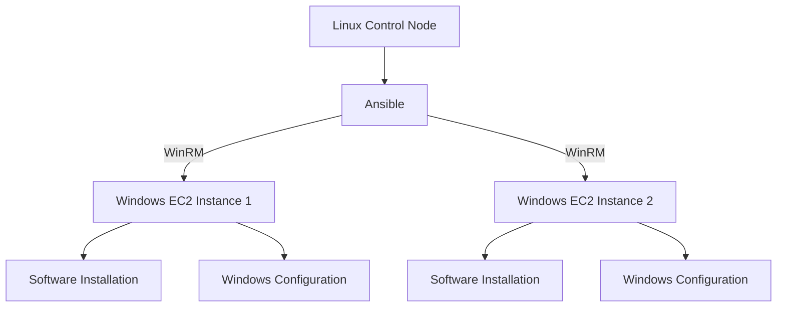

# 🪟 Ansible Windows Automation on AWS EC2

Automating Windows server configuration on AWS EC2 using Ansible playbooks, WinRM, and YAML.

## 📌 Project Overview

This project demonstrates how Ansible can automate the configuration and management of multiple Windows servers hosted on AWS EC2.

Instead of configuring each server manually, a single Ansible playbook can execute predefined tasks across multiple Windows machines, reducing repetitive work and improving consistency.

## 🎯 Project Objectives

- Automate Windows server configuration.
- Manage multiple Windows EC2 instances from a Linux control node.
- Automate software installation and system administration.
- Configure remote Windows management using WinRM.
- Practice Infrastructure as Code and configuration management.
- Apply secure credential-management practices.

## 🚀 Features

- **Multi-server automation:** Manage multiple Windows instances with one playbook.
- **Software installation:** Automate installation of Node.js and Visual Studio Code.
- **Package management:** Use Chocolatey to manage Windows applications.
- **Windows updates:** Automate selected Windows update tasks.
- **User management:** Automate local Windows user creation.
- **Remote administration:** Manage Windows machines through WinRM.
- **Credential protection:** Support Ansible Vault for sensitive variables.
- **Reusable configuration:** Organize inventory, variables, and automation tasks.

## 🏗️ Architecture



## 🛠️ Technologies Used

- AWS EC2
- Ansible
- Linux / Ubuntu
- Windows Server
- WinRM
- YAML
- Chocolatey
- Node.js
- Visual Studio Code
- Ansible Vault
- Git and GitHub

## 📂 Project Structure

```text
ansible-windows-automation/
├── README.md
├── ansible.cfg
├── requirements.yml
├── setup-window.yml
├── inventory.ini.example
├── group_vars/
│   └── windows/
│       ├── vars.yml
│       └── vault.yml.example
└── docs/
    └── screenshots/
```

## ⚙️ Prerequisites

Before running this project, ensure you have:

- A Linux control machine.
- Ansible installed.
- Windows EC2 instances.
- Network connectivity between the control node and Windows servers.
- WinRM configured on the Windows machines.
- Appropriate AWS security group rules.
- Valid Windows credentials stored securely.

## 📥 Setup and Installation

### 1. Install Ansible

On Ubuntu:

```bash
sudo apt update
sudo apt install -y ansible
```

Verify:

```bash
ansible --version
```

### 2. Install Required Collections

From the project directory:

```bash
ansible-galaxy collection install -r requirements.yml
```

### 3. Configure the Inventory

Create a working inventory file:

```bash
cp inventory.ini.example inventory.ini
```

Update it with the private or public IP addresses appropriate to your network configuration.

### 4. Configure Credentials

Create a working copy of the example Vault file:

```bash
cp group_vars/windows/vault.yml.example group_vars/windows/vault.yml
```

Add the required credentials and encrypt the file:

```bash
ansible-vault encrypt group_vars/windows/vault.yml
```

Never upload real passwords, private keys, or unencrypted secret files to a public repository.

### 5. Test Connectivity

```bash
ansible windows -m win_ping --ask-vault-pass
```

A successful response indicates that Ansible can communicate with the target Windows hosts.

### 6. Run the Playbook

```bash
ansible-playbook setup-window.yml --ask-vault-pass
```

The playbook will execute its defined automation tasks on the target Windows machines.

> **Security note:** Configure WinRM using a secure transport and appropriate authentication. Do not expose unencrypted WinRM HTTP or Basic authentication to the public internet. Restrict AWS security group access to trusted sources.

## 📸 Project Screenshots

Add screenshots of your actual implementation to the `docs/screenshots/` directory.

Recommended screenshots:

- AWS EC2 instances.
- Ansible version.
- WinRM configuration.
- Ansible connectivity test.
- Playbook execution summary.
- Node.js installation verification.
- Visual Studio Code installation verification.
- Local user verification.

These screenshots can demonstrate the implementation and successful execution of the project.

## 🔐 Security Considerations

- Use Ansible Vault to protect sensitive credentials.
- Keep private inventory files out of public repositories when they contain sensitive details.
- Never commit AWS access keys or passwords.
- Restrict inbound network access to trusted sources.
- Use secure WinRM configuration.
- Review playbook tasks before running them on production servers.
- Monitor AWS usage and costs.

## 📚 Key Learning Outcomes

Through this project, I developed practical experience with:

- Infrastructure as Code concepts.
- Configuration management using Ansible.
- Windows administration from Linux.
- AWS EC2 infrastructure.
- Remote management using WinRM.
- YAML-based automation.
- Automated software installation.
- Secure credential management.
- Git and GitHub project management.

## 🔮 Future Improvements

- Configure WinRM over HTTPS.
- Add automated YAML validation and Ansible linting.
- Organize tasks into reusable Ansible roles.
- Introduce automated security checks.
- Improve error handling and execution reporting.
- Integrate GitHub Actions for continuous validation.
- Extend automation to additional Windows services.

## 👩‍💻 About This Project

This project demonstrates practical implementation of Ansible-based Windows automation in a cloud environment.

It is part of my ongoing learning journey in cloud computing, infrastructure automation, and DevOps.

## ⭐ Conclusion

Ansible simplifies Windows server management by automating repetitive administrative tasks across multiple machines.

This project provides a practical foundation for understanding configuration management, cloud infrastructure, and automation workflows.
